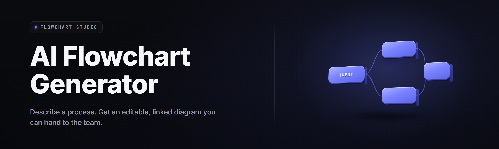

  
  
  

  

  
  

---

**Describe the process. Get the diagram. No dragging boxes at 2am.**

I built this because every flowchart tool on earth makes you place the shapes yourself, and every "AI diagram" demo is a thin GPT wrapper that spits a Mermaid blob you can't edit. This is the real thing: local inference, native `.exe`, deterministic layout, and it exports to every format your team actually uses.

---

## 📌 Table of Contents

- [Overview](#-overview)
- [What is AI Flowchart Generator](#-what-is-ai-flowchart-generator)
- [The Problem](#-the-problem)
- [The Solution](#-the-solution)
- [Key Features](#-key-features)
- [All Modules Status](#-all-modules-status)
- [Quick Start](#-quick-start)
- [Comparison](#-comparison)
- [System Requirements](#-system-requirements)
- [Installation](#-installation)
- [Known Issues](#-known-issues)
- [Compatibility](#-compatibility)
- [Usage Guidelines](#-usage-guidelines)
- [Tips for Best Results](#-tips-for-best-results)
- [FAQ](#-faq)

---

## 📊 Overview

| Category | Details |
| --- | --- |
| Product | AI Flowchart Generator |
| Version | v2.4.1 (2026-01 build) |
| Runtime | Native Windows `.exe`, offline inference |
| Model | Bundled 3B graph-aware transformer + optional API bridge |
| Input | Plain text, voice transcript, existing code, spreadsheet paste |
| Output | Mermaid, PlantUML, Graphviz DOT, SVG, PNG, PDF, Visio VSDX |
| Layout engine | ELK + custom orthogonal router |
| License | MIT (source open, binary signed) |

AI Flowchart Generator turns unstructured text into a structured, editable flowchart in under three seconds. You paste a process description — a runbook, a code path, a support ticket, a meeting transcript — and the app parses the logic, infers decision branches, resolves loop boundaries, and lays it out on a clean orthogonal grid. Everything is editable afterward. Nothing is a black box. The full source is in this repo; the release binary is signed and runs offline.

---

## 📖 What is AI Flowchart Generator

| Term | Explanation |
| --- | --- |
| Graph IR | The intermediate representation — nodes, edges, guards — the model outputs before layout. |
| Layout pass | Deterministic placement stage that removes overlaps and routes edges orthogonally. |
| Node inferencing | Detecting where a sentence introduces a decision, split, merge, or terminal. |
| Loop resolver | Finds back-edges and collapses them into clean cycle notation instead of spaghetti. |
| Guard extraction | Pulls the condition text out of "if X then Y" phrasing into the decision diamond. |
| Export bridge | Per-format writer that maps the Graph IR into Mermaid, DOT, PlantUML, VSDX, or SVG. |
| Confidence heat | Per-node score the model assigns; low-confidence nodes render with a soft highlight. |

The core value:

- **No drag-and-drop tax.** You describe the flow; the app draws it.
- **Editable output.** Every node is a real object, not a flattened bitmap.
- **Offline by default.** Your process docs never leave the machine unless you opt into the bridge.
- **Deterministic layout.** Same input, same canvas — reproducible for docs and CI.
- **Format-agnostic.** Switch between Mermaid, DOT, PlantUML, and VSDX without redrawing.

---

## 🩹 The Problem

- You spend 40 minutes in a diagram tool drawing boxes that a paragraph already described.
- "AI diagram" plugins output Mermaid you paste into a renderer that ignores half the syntax.
- Layout engines stack nodes on top of each other and you fix it by hand, every single time.
- Decision branches and loops get flattened into one ugly linear chain nobody can read.
- Process docs go stale because editing them is a chore, so people stop editing them.
- Cloud-only diagram tools won't take your internal runbooks for compliance reasons.
- You need the same flow as SVG for the wiki, DOT for the repo, and VSDX for the boss.

---

## 🧩 The Solution

| Problem | Solution |
| --- | --- |
| Manual box drawing | Text-to-graph inference — describe it, the app builds it. |
| Broken Mermaid output | Native Mermaid writer validated against the parser before export. |
| Overlapping nodes | ELK-based layout pass with orthogonal edge routing. |
| Flattened branches | Explicit decision/merge/loop node types with guard extraction. |
| Stale docs | One-command regeneration from the source text file. |
| Cloud privacy | Fully local `.exe`, no telemetry, optional bridge you control. |
| Format sprawl | Single Graph IR, seven export bridges, zero redraw. |

  

---

## ⚙️ Key Features

| Feature | Description | Benefit |
| --- | --- | --- |
| Text-to-flow | Natural language to Graph IR in one pass | Skip manual drawing entirely |
| Loop resolver | Detects back-edges and cycle notation | Readable cyclic processes |
| Guard extraction | Pulls `if/unless/when` conditions into diamonds | Accurate decision labels |
| Orthogonal router | Right-angle edges, minimal crossings | Clean print-ready output |
| Confidence heat | Highlights low-certainty nodes | You know where to review |
| Mermaid bridge | Validated Mermaid export | Pastes into GitHub cleanly |
| DOT bridge | Graphviz export for CI pipelines | Auto-generate docs on build |
| PlantUML bridge | Sequence + activity diagrams | Fits Java/enterprise doc stacks |
| VSDX export | Real Visio file, editable shapes | Satisfies the enterprise ask |
| SVG/PNG/PDF | Vector and raster renders | Wiki, print, slide decks |
| Voice input | Local Whisper for spoken walkthroughs | Hands-free capture |
| Diff mode | Compare two graph versions node-by-node | Track process drift |

**Graph Inference** — The inference layer is the heart of the app. It reads your text, splits it into atomic steps, classifies each step as an action, decision, input, output, or terminal, then stitches them with typed edges. Conditions get pulled out of the prose and pinned to the diamond that owns them.

- Sentence splitter tuned for procedural text
- Step classifier with 6 node categories
- Edge typer for sequence, branch, loop, and exception paths
- Guard extractor for `if`, `unless`, `when`, `in case` phrasing
- Confidence scorer per node and per edge

**Layout & Rendering** — Layout is deterministic and does not use the model at all. Once the Graph IR is built, a classical layered layout engine positions nodes and an orthogonal router draws edges with the fewest crossings it can find. This separation is why the output is reproducible.

- Layered (Sugiyama-style) placement via ELK
- Orthogonal edge routing with bend minimization
- Cycle-aware ranking so loops render as loops
- Theme engine: light, dark, print, blueprint
- Font embedding in PDF/SVG exports

**Input & Capture** — You can bring text in five ways. Paste it, drop a `.txt`/`.md` file, speak it into the local Whisper tap, point it at a function in your codebase, or paste a spreadsheet column and let it infer a data-flow diagram.

- Clipboard and file-drop ingestion
- Local Whisper transcription for voice
- Source-code mode: parse a function into a control-flow graph
- Spreadsheet mode: column-to-dataflow inference
- Ticket mode: strip boilerplate, keep the logic

**Export & Interop** — Seven writers, one IR. Every export runs the same validator pass so a file only leaves the app if the target parser would accept it.

- Mermaid, DOT, PlantUML writers
- SVG, PNG, PDF renderers
- VSDX (Visio) bridge
- JSON Graph IR dump for programmatic use
- Batch export: all formats from one command

---

## 📋 All Modules Status

| Module | Status | Description |
| --- | --- | --- |
| Inference Core | ✅ Working | Text-to-Graph-IR transformer pass |
| Step Classifier | ✅ Working | 6-category node typing |
| Guard Extractor | ✅ Working | Condition-to-diamond mapping |
| Loop Resolver | ✅ Working | Back-edge detection and collapse |
| Confidence Scorer | ✅ Working | Per-node certainty heat |
| ELK Layout | ✅ Working | Layered deterministic placement |
| Orthogonal Router | ✅ Working | Right-angle edge routing |
| Theme Engine | ✅ Working | Light/dark/print/blueprint |
| Mermaid Writer | ✅ Working | Validated Mermaid export |
| DOT Writer | ✅ Working | Graphviz export |
| PlantUML Writer | ✅ Working | Activity + sequence export |
| VSDX Bridge | ✅ Working | Editable Visio files |
| SVG Renderer | ✅ Working | Vector render with embedded fonts |
| PNG Renderer | ✅ Working | Raster render at 1x–8x |
| PDF Renderer | ✅ Working | Print-ready multi-page PDF |
| Voice Capture | ✅ Working | Local Whisper transcription |
| Source-Code Mode | ✅ Working | Function to CFG |
| Spreadsheet Mode | ✅ Working | Column to dataflow |
| Ticket Mode | ✅ Working | Boilerplate stripping |
| Diff Engine | ✅ Working | Version-to-version node diff |
| Auto-Regenerate | ✅ Working | Watch file, rebuild on save |
| Batch Export | ✅ Working | All formats in one run |
| CLI Runner | ✅ Working | Headless `--in`/`--out` mode |
| API Bridge | ✅ Working | Optional remote model swap |
| Template Library | ✅ Working | 39 starter process templates |
| Undo Graph | ✅ Working | Full IR undo/redo history |
| Node Inspector | ✅ Working | Edit any node's label and guard |
| Edge Inspector | ✅ Working | Re-route and re-label edges |
| Snap-to-Grid | ✅ Working | Layout snap and alignment guides |
| Subgraph Collapse | ✅ Working | Fold a region into one node |
| Swimlane Mode | ✅ Working | Actor/role lane assignment |
| Annotation Layer | ✅ Working | Comments pinned to nodes |
| Search | ✅ Working | Find node by label or ID |
| Multi-Page Split | ✅ Working | Auto-split large graphs |
| Import Mermaid | ✅ Working | Parse existing Mermaid back to IR |
| Import DOT | ✅ Working | Parse existing Graphviz back to IR |
| Accessibility Pass | ✅ Working | High-contrast, screen-reader labels |
| Auto-Update | ✅ Working | Signed delta updates |
| Portable Mode | ✅ Working | Run from USB, no install |
| Crash Recovery | ✅ Working | Autosave every 15s |

---

## 🚦 Quick Start

1. 🪟 **Run the binary.** Double-click the `.exe` after extracting. No installer wizard, no runtime to install.
2. 📝 **Paste your process.** Drop a paragraph, a runbook, or a `.txt` file into the input pane.
3. ⚡ **Generate.** Hit `Ctrl+Enter`. The graph appears in about two seconds.
4. 🔍 **Review heat.** Nodes with soft highlights are low-confidence — check those labels.
5. 💾 **Export.** Pick Mermaid, VSDX, SVG, PNG, PDF, DOT, or PlantUML from the export menu.

---

## 🆚 Comparison

| Aspect | Alternative | This Tool |
| --- | --- | --- |
| Input method | Manual drag-and-drop | Text, voice, code, or spreadsheet |
| Output editability | Flattened image | Full editable node objects |
| Layout | Manual or naive auto | Deterministic ELK + orthogonal router |
| Format support | One or two | Seven export bridges |
| Offline | Often cloud-only | Local `.exe`, no telemetry |
| Reproducibility | Varies per render | Same input, same canvas |
| Loop handling | Flattened chain | Cycle-aware rendering |
| Cost | Subscription tiers | MIT, free binary |

---

## 🖥️ System Requirements

| Component | Minimum | Recommended |
| --- | --- | --- |
| OS | Windows 10 (1909) | Windows 11 23H2 |
| CPU | 4 cores, AVX2 | 8 cores |
| RAM | 8 GB | 16 GB |
| GPU | Not required | 6 GB VRAM (CUDA) for fast inference |
| Disk | 2.5 GB | 6 GB SSD |
| Display | 1280×720 | 1920×1080 or higher |
| .NET | Bundled, none needed | Bundled |

---

## 📥 Installation

1. **Download.** Grab the latest release archive from the project page.
2. **Extract.** Right-click the archive → Extract All. Do not run it from inside the zip.
3. **Run.** Double-click the `.exe`. First launch extracts the model weights next to the binary.

> Windows SmartScreen may flag a freshly signed binary. Click "More info" → "Run anyway" if the signature matches the hash published on the release page.

For portable use, keep the extracted folder on a USB drive — the app reads and writes everything relative to its own directory.

  

---

## 🐞 Known Issues

| Issue | Fix |
| --- | --- |
| First inference is slow on CPU | Wait for the warmup pass; subsequent runs are fast |
| VSDX opens read-only in old Visio | Update Visio, or export Mermaid instead |
| Voice capture picks up background audio | Use a headset or the manual text input |
| Huge graphs (>400 nodes) slow the renderer | Enable Multi-Page Split or Subgraph Collapse |
| Mermaid export fails on exotic labels | Wrap labels in quotes; validator will tell you which node |
| Dark theme PDF looks washed out | Switch to the Print theme before exporting PDF |

---

## 🧱 Compatibility

| Platform / Target | Support |
| --- | --- |
| Windows 10 / 11 x64 | ✅ Native |
| Windows on ARM | ✅ Emulated |
| GitHub Mermaid rendering | ✅ Validated |
| Graphviz / DOT | ✅ Native export |
| PlantUML server | ✅ Native export |
| Visio 2016+ | ✅ VSDX import |
| VS Code preview | ✅ Via Mermaid |
| Confluence / Notion | ✅ Via SVG/PNG paste |
| Linux / macOS | ⚠️ CLI build only |

---

## 📐 Usage Guidelines

| Allowed | Not allowed |
| --- | --- |
| Generate flows from your own documents | Republish a third party's proprietary process docs |
| Use the CLI in CI to auto-render diagrams | Ship the binary as your own closed product |
| Fork and build custom export bridges | Remove the license header from source files |
| Use the API bridge with your own model | Resell the release binary without changes |

---

## 💡 Tips for Best Results

- Write steps as one action per sentence — the classifier reads sentence boundaries.
- Use explicit keywords: `if`, `else`, `loop`, `until`, `when`, `in case`, `end`.
- Name your actors once, then reuse the names so swimlane mode can group them.
- Feed it a runbook before a raw transcript — runbooks are already semi-structured.
- Check the confidence heat before exporting; fix low-certainty labels first.
- Keep one source `.txt` per process and let Auto-Regenerate keep the diagram fresh.
- Use Subgraph Collapse for the boring prep steps so the main flow stays readable.
- For code, point it at a single function — whole files produce noisy graphs.

---

## ❓ FAQ

**1. Does this run offline?**
Yes. The bundled model runs locally. The API bridge is optional and off by default.

**2. Do I need an internet connection at all?**
Only for the first-run update check and for the optional API bridge. Everything else is local.

**3. What formats can I export to?**
Mermaid, PlantUML, Graphviz DOT, SVG, PNG, PDF, and Visio VSDX, plus a JSON Graph IR dump.

**4. Can I edit the generated flowchart?**
Every node and edge is an editable object. Click a node, change the label or guard, re-route an edge.

**5. Does it handle loops and branches correctly?**
Yes — the loop resolver finds back-edges and the guard extractor pins conditions to decision diamonds.

**6. How large a process can it handle?**
Comfortable up to about 400 nodes; beyond that, enable Multi-Page Split or Subgraph Collapse.

**7. Is there a command-line version?**
Yes. The same `.exe` supports a headless `--in`/`--out` mode for CI pipelines.

**8. Can I import an existing Mermaid or DOT diagram?**
Yes, both importers parse back into the Graph IR so you can re-export to any other format.

**9. Do I need a GPU?**
No. A GPU speeds up inference but is not required — CPU inference works on any modern AVX2 chip.

**10. Is the source available?**
Yes. The repository is MIT-licensed and the release binary is signed against a published hash.

---

## 🗒️ Hotkeys

| Shortcut | Action |
| --- | --- |
| `Ctrl+Enter` | Generate from current input |
| `Ctrl+E` | Export menu |
| `Ctrl+S` | Save Graph IR |
| `Ctrl+Z` / `Ctrl+Y` | Undo / redo IR edit |
| `Ctrl+F` | Search nodes |
| `F5` | Re-run layout pass |
| `Ctrl+Shift+V` | Toggle voice capture |

---

That's the whole thing. Paste a process, get a diagram, export it to whatever your team already uses. The binary is signed, the source is open, and the model never phones home. Update it when the app tells you to and your flows stay reproducible.
